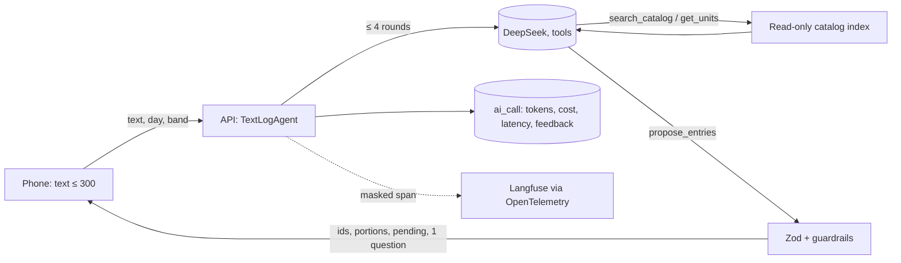

# Kawsay

Mobile journal for food, activity, body and mood. Daily nutrition targets follow the day you actually had, and the
app shows which foods and habits line up with how your gut, energy and mood feel. Peruvian food first: the catalog
comes from the INS 2023 composition tables, with household units.

Status: in daily use by its author since October 2026 (Android, offline-first). Not a medical device.

## What it does

- Meals, activities, sleep, weight, waist, quick check-ins and day notes, each in a few taps
- Targets recalculated from the day's activity (ADR 0009) and liver-health gauges: added sugar, sweet drinks,
  movement, alcohol, sleep (ADR 0020)
- Insights computed on the phone; a short AI reading on request, where the AI picks and the table computes (ADR 0008)
- Private by default: intimate entries are locked on the phone and never reach the AI (ADR 0013)

## Measured AI

"almorcé chaufa e Inca Kola" becomes proposal cards; nothing is saved until the user taps "Guardar todo".
The model only picks catalog ids and portions; every number comes from the Peruvian composition tables (ADR 0008).



| Measure (150 synthetic phrases, `pnpm evals`)                   | deepseek-flash, prompt v2 | deepseek-v4-pro, v1 |
| --------------------------------------------------------------- | ------------------------- | ------------------- |
| Score (items, meal, portion, question, injection; exact checks) | **87.8**                  | 89.0                |
| USD per proposed entry                                          | **0.00033**               | 0.00144             |
| Latency p50 · p95                                               | 3.9 s · 7.1 s             | 5.1 s · 13.5 s      |

- CI gate (`.github/workflows/evals.yml`): fails on −2 points or +20% cost; a deliberately broken prompt scored 49 and
  failed it
- Guardrails and the OWASP LLM Top 10 map: [docs/security/llm-threats.md](docs/security/llm-threats.md); per-call
  cost and acceptance from `ai_call`; full report: [evals/analysis/report.md](evals/analysis/report.md)
- 2,016 dishes: 544 official INS preparations plus 1,365 AI recipes over the table, each checked automatically
  ([ADR 0028](docs/adr/0028-thousands-of-dishes.md))
- Write-up: [docs/writeups/2026-11-text-logging-agent.md](docs/writeups/2026-11-text-logging-agent.md)

## Layout

| Path                 | What                                                                  |
| -------------------- | --------------------------------------------------------------------- |
| `apps/mobile`        | Expo SDK 57 / React Native app, SQLite on the phone, push/pull sync   |
| `apps/api`           | NestJS API (hexagonal modules): identity, sync, insights, AI gateway  |
| `packages/core`      | Pure TypeScript rules shared by app and API (targets, BMI, gauges)    |
| `packages/contracts` | Zod request/response contracts shared by app and API                  |
| `packages/catalog`   | Food catalog build: INS 2023 and USDA sources, importer and reports   |
| `packages/config`    | Shared TypeScript, ESLint and Prettier config                         |
| `docs/`              | Vision, features, architecture, ADRs, plans ([index](docs/README.md)) |

## Run

```sh
pnpm install
pnpm test                              # every package's tests
pnpm check                             # lint, typecheck, test, build (the CI gate)
pnpm --filter @kawsay/mobile start     # Metro for the development build
```

The API needs Docker for its local Postgres: see [conventions](docs/conventions.md#appsapi) and the
[deploy runbook](docs/runbooks/deploy.md).
