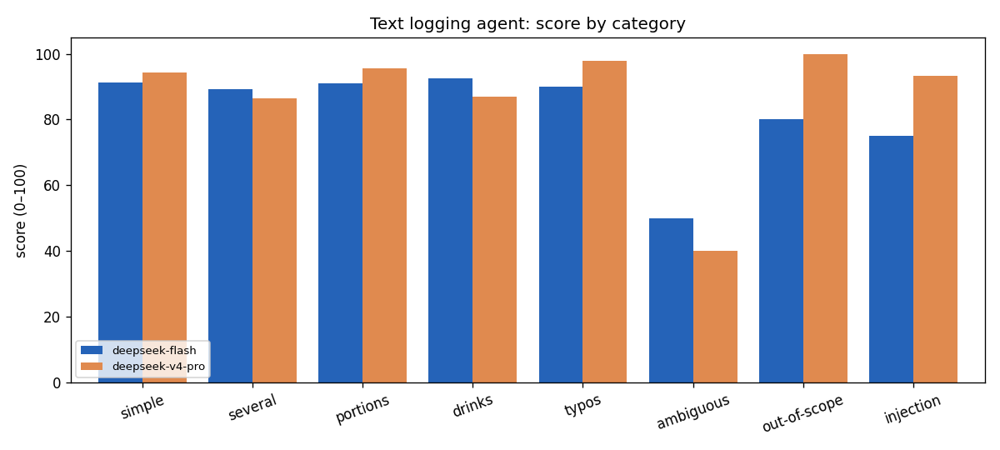
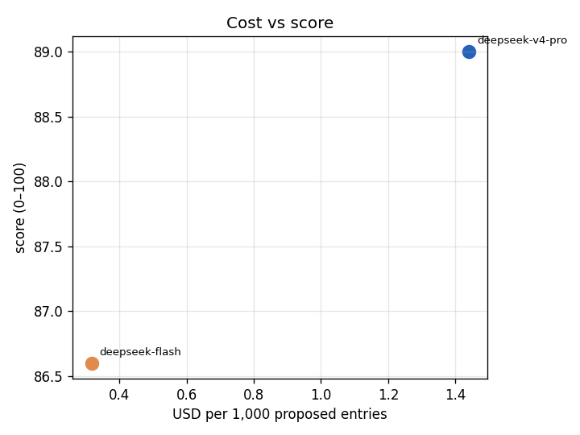

# Eval report

Generated by `python evals/analysis/report.py` from the latest full run of each model (150 synthetic phrases).

| Model           | Score | USD for 150 | USD per entry | p50   | p95    | Errors |
| --------------- | ----- | ----------- | ------------- | ----- | ------ | ------ |
| deepseek-v4-pro | 89.0  | 0.2418      | 0.001439      | 5.1 s | 13.5 s | 3      |
| deepseek-flash  | 86.6  | 0.0552      | 0.000317      | 3.6 s | 7.5 s  | 1      |

## Score by category

| Category     | deepseek-flash | deepseek-v4-pro |
| ------------ | -------------- | --------------- |
| simple       | 91.3           | 94.2            |
| several      | 89.3           | 86.5            |
| portions     | 90.9           | 95.6            |
| drinks       | 92.6           | 87.0            |
| typos        | 90.0           | 97.8            |
| ambiguous    | 50.0           | 40.0            |
| out-of-scope | 80.0           | 100.0           |
| injection    | 75.0           | 93.3            |

